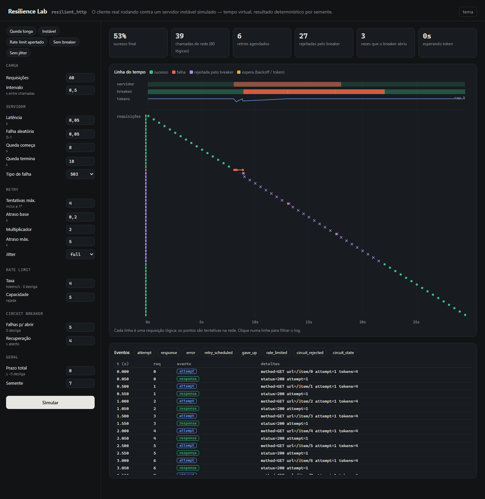
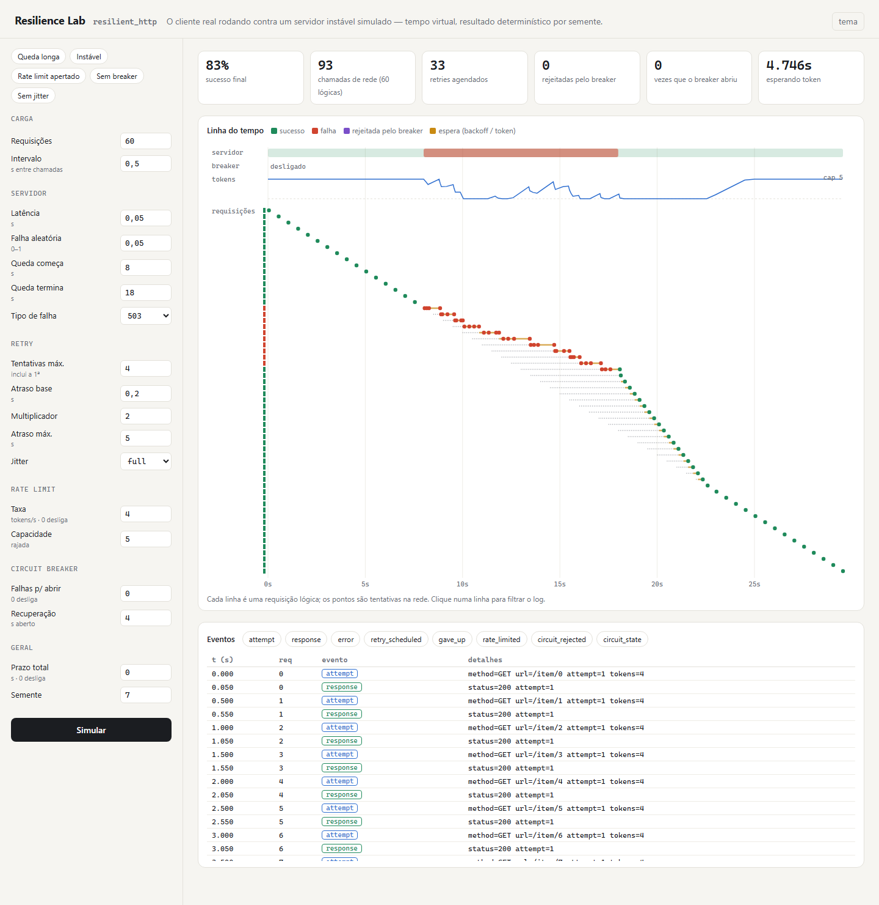
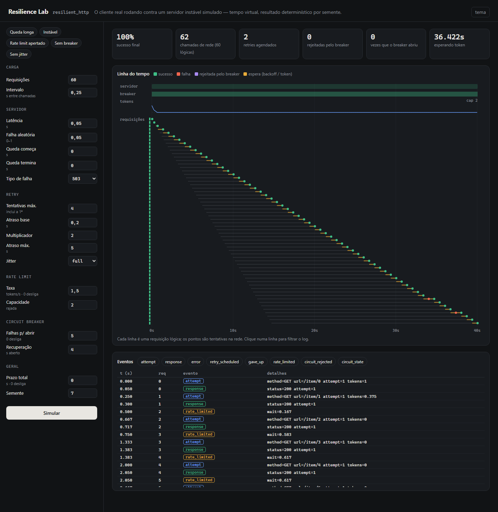
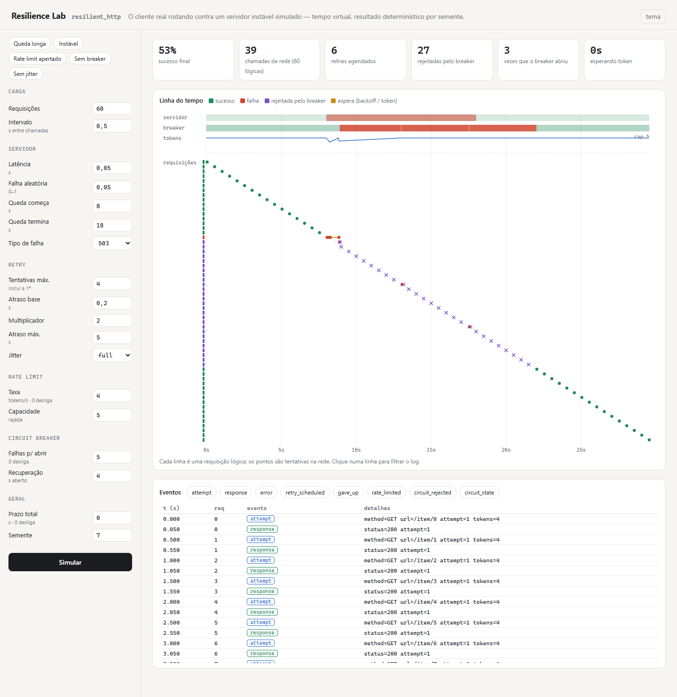
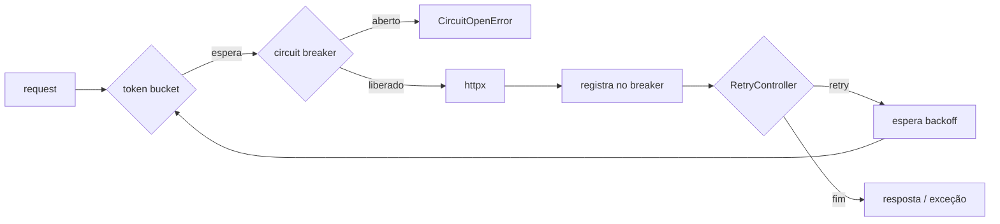
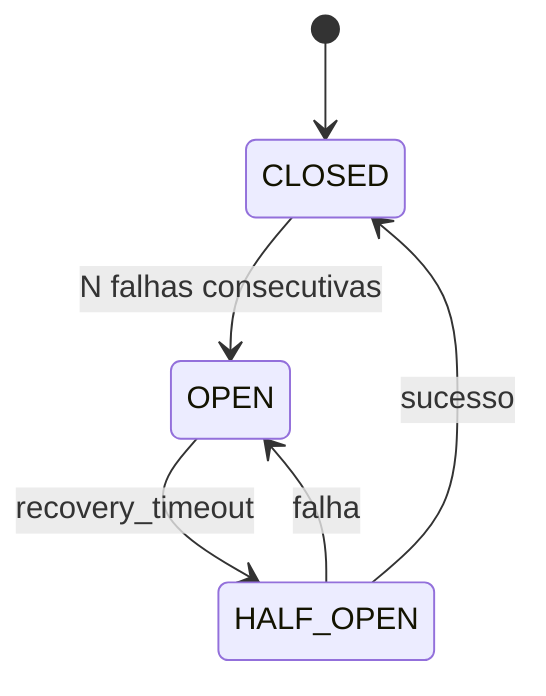

<div align="center">

# resilient_http

**Cliente HTTP resiliente para Python, construído sobre o [httpx](https://www.python-httpx.org/).**

Retry com backoff exponencial e jitter · Rate limiting por token bucket · Timeouts configuráveis · Circuit breaker




<sub>O <b>Resilience Lab</b>: o cliente real rodando contra um servidor que cai entre 8s e 18s.
O breaker (faixa vermelha) abre e as chamadas viram rejeições imediatas (✕ roxo), sem tocar a rede.</sub>

</div>

---

## Sumário

- [Por que](#por-que)
- [Recursos](#recursos)
- [Começando](#começando)
- [Uso](#uso)
- [Resilience Lab (dashboard)](#resilience-lab-dashboard)
- [Arquitetura](#arquitetura)
- [Testes](#testes)

## Por que

Toda chamada a um serviço externo pode falhar: o servidor cai por alguns segundos, a rede
oscila, a API impõe limite de requisições ou uma resposta nunca chega. Com o `httpx` puro, cada
um desses casos vira tratamento manual espalhado pelo código.

O `resilient_http` empacota os padrões clássicos de resiliência atrás da mesma interface do
`httpx`: você chama `client.get(...)` e as proteções acontecem por baixo.

## Recursos

| | Padrão | O que faz |
|---|---|---|
| 🔁 | **Retry com backoff + jitter** | Repete falhas temporárias (429, 502, 503, 504, erros de rede) com espera exponencial e aleatoriedade (`full`, `equal` ou `none`) para evitar a "manada". Respeita `Retry-After`. |
| 🪣 | **Token bucket** | Limita chamadas por segundo permitindo rajadas. Modelo de *reserva*: justo (FIFO) e seguro para threads e asyncio. |
| ⏱️ | **Timeouts** | Por fase (connect, read, write, pool) e um **prazo total** opcional que cobre todas as tentativas e encurta o timeout de cada uma para caber no que resta. |
| 🔌 | **Circuit breaker** | Abre após *N* falhas consecutivas, rejeita na hora enquanto aberto e testa a recuperação em estado meio-aberto. |
| 🛡️ | **Retry seguro** | Só repete métodos idempotentes, exceto quando o erro prova que a requisição nem saiu (`ConnectError`), caso em que até `POST` é repetido. |
| 📡 | **Eventos** | Emite `Event`s (`attempt`, `retry_scheduled`, `circuit_state`…) para logging, métricas ou dashboards, sem acoplamento. |
| ⚡ | **Sync e async** | `ResilientClient` e `AsyncResilientClient` com a mesma API e a mesma lógica. |

## Começando

```bash
git clone https://github.com/nicolas-marini/resilient-http.git
cd resilient-http
python -m venv .venv
.venv\Scripts\activate            # Windows  ·  Linux/macOS: source .venv/bin/activate
pip install -e ".[dev]"

pytest                            # 145 testes em < 1s
python -m resilient_http.demo     # abre o dashboard em http://127.0.0.1:8765
```

## Uso

```python
from resilient_http import (
    ResilientClient, RetryPolicy, RateLimitConfig,
    CircuitBreakerConfig, TimeoutConfig, CircuitOpenError,
)

with ResilientClient(
    "https://api.exemplo.com",
    retry=RetryPolicy(max_attempts=4, base_delay=0.2, max_delay=5, jitter="full"),
    rate_limit=RateLimitConfig(rate=10, capacity=20),          # 10 req/s, rajadas de 20
    circuit_breaker=CircuitBreakerConfig(failure_threshold=5, recovery_timeout=30),
    timeout=TimeoutConfig(connect=2, read=5, total=15),        # prazo total de 15s
    on_event=lambda e: print(f"{e.time:.2f} {e.kind} {e.data}"),
) as client:
    try:
        resposta = client.get("/pedidos/42")
        resposta.raise_for_status()
    except CircuitOpenError as e:
        print(f"Serviço indisponível; tente novamente em {e.retry_after:.0f}s")
```

<details>
<summary><b>Versão assíncrona</b></summary>

```python
import asyncio
from resilient_http import AsyncResilientClient, RetryPolicy

async def main():
    async with AsyncResilientClient("https://api.exemplo.com",
                                    retry=RetryPolicy(max_attempts=3)) as client:
        respostas = await asyncio.gather(*(client.get(f"/itens/{i}") for i in range(10)))
        print([r.status_code for r in respostas])

asyncio.run(main())
```

</details>

<details>
<summary><b>Referência de configuração</b></summary>

| Classe | Campo | Padrão | Descrição |
|---|---|---|---|
| `RetryPolicy` | `max_attempts` | `3` | Total de tentativas, incluindo a primeira |
| | `base_delay` / `multiplier` / `max_delay` | `0.1` / `2.0` / `10.0` | Espera *n* = `min(max_delay, base · multiplier^(n-1))` |
| | `jitter` | `"full"` | `full` = U[0, d] · `equal` = d/2 + U[0, d/2] · `none` |
| | `retry_on_status` | `{429, 502, 503, 504}` | Status que disparam retry |
| | `retry_methods` | idempotentes | Métodos que podem ser repetidos |
| | `respect_retry_after` | `True` | Usa o cabeçalho `Retry-After` (desiste se > `max_delay`) |
| `RateLimitConfig` | `rate` / `capacity` | — | Tokens por segundo / tamanho da rajada |
| | `max_wait` | `None` | Espera máxima por token; acima disso lança `RateLimitExceeded` |
| `CircuitBreakerConfig` | `failure_threshold` | `5` | Falhas consecutivas para abrir |
| | `recovery_timeout` | `30.0` | Segundos aberto antes de testar (meio-aberto) |
| | `half_open_max_calls` | `1` | Chamadas de teste simultâneas |
| | `failure_status_codes` | `500–599` | Status que contam como falha (4xx não conta) |
| `TimeoutConfig` | `connect` / `read` / `write` / `pool` | `5` / `10` / `10` / `5` | Timeouts por fase, repassados ao httpx |
| | `total` | `None` | Prazo para a operação inteira, com retries |

Passe `circuit_breaker=None` ou `rate_limit=None` (padrão) para desligar cada proteção.

</details>

## Resilience Lab (dashboard)

`python -m resilient_http.demo` abre um laboratório que roda o **cliente real** contra um
servidor instável simulado (`httpx.MockTransport`) usando um **relógio virtual**: 30 segundos
simulados levam milissegundos, e a mesma semente sempre produz o mesmo resultado.

A linha do tempo mostra a janela de queda do servidor, os estados do breaker, o saldo de tokens
e cada requisição com suas tentativas. Ao lado, ajuste qualquer parâmetro ou use os presets.

| Sem circuit breaker | Rate limit apertado |
|---|---|
|  |  |
| Sem o breaker, o cliente continua martelando o servidor durante toda a queda: **93 chamadas de rede** para 60 requisições, e cada uma demora mais. | Com 1,5 token/s e chamadas a cada 0,25s, todas dão certo, mas a fila de espera por token cresce até ~36s no total. |

> Dica: a URL aceita `?theme=dark|light` e `?preset=Sem%20breaker` para compartilhar um cenário.

<details>
<summary>Tema claro</summary>

</details>

## Arquitetura

```
resilient_http/
├── config.py            políticas imutáveis e validadas (dataclasses congelados)
├── clock.py             Clock (Protocol) · SystemClock · FakeClock
├── backoff.py           backoff exponencial + jitter            ┐
├── rate_limiter.py      TokenBucket por reserva                 │  núcleo sans-IO:
├── circuit_breaker.py   máquina de estados do breaker           │  só decide, não dorme
├── retry.py             RetryController: se e quanto esperar    ┘  nem chama a rede
├── client.py            _ResilienceCore + fachadas sync/async (só I/O)
├── events.py            Event e EventHandler
└── demo/                simulador, servidor (stdlib) e dashboard HTML
```

Cada tentativa percorre o mesmo caminho:



E o breaker segue esta máquina de estados, com transição *preguiçosa* (sem timers nem threads):



**Decisões de design**

- **Sans-IO.** As políticas só *decidem*. Quem dorme e chama a rede são as fachadas, por isso
  `ResilientClient` e `AsyncResilientClient` compartilham 100% da lógica com laços de ~20 linhas.
- **Relógio injetável.** Com `FakeClock`, `sleep` só avança um contador: os testes afirmam
  `clock.sleeps == [1, 2, 4]` e rodam instantaneamente.
- **Token bucket por reserva.** `reserve()` debita na hora (o saldo pode ficar negativo) e
  devolve quanto esperar. O lock nunca é mantido durante a espera.
- **Observabilidade desacoplada.** O cliente não faz log; emite eventos. O dashboard é só mais
  um ouvinte.

## Testes

```bash
pytest -q
```

| Arquivo | Cobre |
|---|---|
| `test_backoff.py` | crescimento exponencial, teto, limites de cada jitter, determinismo por semente |
| `test_rate_limiter.py` | rajada, esperas FIFO, reabastecimento, `max_wait` sem consumir token |
| `test_circuit_breaker.py` | abertura, reset por sucesso, meio-aberto, limite de chamadas de teste |
| `test_client.py` | integração sync e async com `httpx.MockTransport` e um `ScriptedServer` que segue um roteiro (`[503, ConnectError(...), 200]`) |
| `test_demo.py` | determinismo do simulador e servidor HTTP de ponta a ponta |

Nenhum teste toca a rede real nem dorme de verdade.
